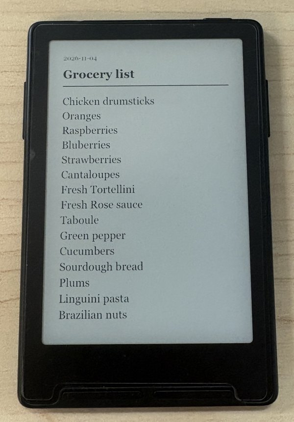

# To Do List for CrossPoint

Send a to-do list from your iPhone to your Xteink X3 or X4 and see it every time the reader sleeps.

<p align="center">
  
</p>

To Do List is a plugin for CrossPoint 2.0. It adds a **To Do List** card to the reader's web File Manager page:

- **Saves each list** as a plain `.txt` file in `/Notes`, so you can also open it from the Library like a book. Right-to-left text such as Arabic works too.
- **Turns the list into your sleep screen.** When you press **Save to reader**, the card draws the list as `/sleep/note.bmp`.
- **Fills itself in from your iPhone.** The Apple Shortcut below opens the card with your list already typed in, so all you do is press **Save to reader**.

## Install

1. Install **To Do List** from Plugin Hub, or copy the `to-do-list.crosspoint-plugin` folder to the SD card as `/plugins/to-do-list/`.
2. On the reader, turn on **Settings → Connectivity → Plugins**.
3. Set **Settings → Display → Sleep Screen → Custom**.

Requires CrossPoint 2.0 or later.

## iPhone Shortcut: "Send Sleep Note"

The quickest way to use the plugin is the ready-made Apple Shortcut.

**[Get the "Send Sleep Note" shortcut](https://www.icloud.com/shortcuts/8f597c245bcf4871993a44c5b4aca441)**

Open the link on your iPhone and tap **Add Shortcut**.

### Using it

1. On the reader, open **File Transfer** and join your home WiFi.
2. On the iPhone, connected to the same WiFi, open a note or list and tap **Share → Send Sleep Note**.
3. Safari opens the To Do List card with your list filled in. Check it, then press **Save to reader**.
4. Wait for **Done** on the card, then put the reader to sleep. Your list is the sleep screen.

### Tips

- **Allow local network access.** The first time the shortcut runs, iOS asks whether Shortcuts can reach devices on your local network. Tap **Allow**.
- **If `crosspoint.local` doesn't load,** edit the shortcut and replace `crosspoint.local` with the IP address shown on the reader's File Transfer screen.
- **Only the list is shown.** Saving deletes any other `.bmp` files in `/sleep`, along with CrossPoint's cached sleep images, so your list is the only sleep image. Move pictures you want to keep out of `/sleep` first.

### Build your own

The shortcut opens the card with a link like this:

```
http://crosspoint.local/files#title=<URL-encoded title>&body=<URL-encoded list>
```

A minimal version has three actions: **Get Text from Input** → **URL Encode** → **Open URLs** `http://crosspoint.local/files#note=[URL Encoded Text]`. With `#note=`, the first line becomes the title.

The part after `#` stays in Safari and is never sent to the reader in the address, so long lists, `&`, `+` and emoji are fine. Nothing is uploaded until you press **Save to reader**.

## How it works

Plugins can't run code on the reader itself, so the card does the work in your browser:

- Each list is saved as `/Notes/<date> <title>.txt`.
- The sleep image is drawn as a 24-bit uncompressed BMP, the format CrossPoint's Custom sleep screen needs. It is 528×792 for the X3 and 480×800 for the X4; choose your device on the card.
- Before uploading, the card deletes the `.bmp` files already in `/sleep`. It also deletes CrossPoint's cached sleep images: `.bmp` files at the top of `/.crosspoint` whose name contains `sleep`.
- Tap **Wallpaper** next to any saved list to make it the sleep screen again.
